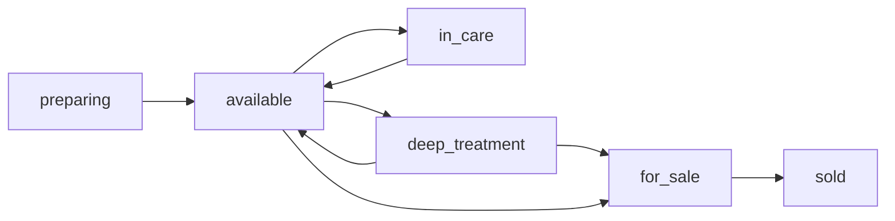
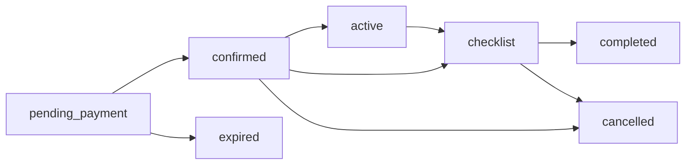

# אפיון מוצר — מגרש רכב

זה מסמך המוצר: מה המערכת עושה. איך בונים אותה, כולל ארכיטקטורה, גיטהאב, יומן שינויים ושיטת תכנות: [Rules.md](Rules.md). יומן השינויים: [CHANGES.md](CHANGES.md).

מסמך זה נועל את גרסה 1 של אתר השכרה ומכירה למגרש אחד בישראל. הוא מחליט מסכים, שדות, מצבים, מחירים, הרשאות וארכיטקטורה. מה שלא כתוב כאן לא נכנס לגרסה.

אחרי אישור המסמך בונים לפיו. אין במסמך הזה קוד, סכמת מסד, או חיבור חי לסליקה.

## 1. מטרה

לקוח נכנס לאתר ובוחר השכרה או קנייה. הוא רואה רק רכבים שמתאימים למה שהזין, ותמיד עם מחיר.

עובדי המגרש מעלים רכבים, מתמחרים כל רכב, מנהלים זמינות, וסוגרים כל השכרה בצ׳קליסט לפני שהרכב חוזר לצי. רכב שנקנה חדש להשכרה עובר, אחרי סף גיל או קילומטראז׳ וטיפול מעמיק, למכירה.

המוצר נבנה כך שאפשר להפעיל אותו קודם בסביבת בדיקות, ואחר כך לחבר סליקה ישראלית בלי לשנות הזמנות, מחירים או מסכים.

## 2. החלטות מוצר

- מגרש אחד. איסוף תמיד במגרש. החזרה למגרש, או לכתובת שהלקוח כותב.
- האתר בעברית, כיוון ימין לשמאל, בשקלים. המחיר ללקוח כולל מע״מ.
- גלישה בלי חשבון. חשבון אפשר לפתוח לפני התשלום ב-`/register`, וגם במסך התשלום אם עדיין אין חשבון. השדות: שם מלא, טלפון, אימייל, תאריך לידה, סיסמה.
- אין בגרסה זו העלאת רישיון, תעודת זהות, או מספר זהות.
- השכרה משולמת במלואה מראש בכרטיס. מכירה: מקדמה של 10% באתר, והיתרה במגרש בקבלת הרכב.
- מימון וטרייד-אין נרשמים כבקשה על ההזמנה. האתר לא מחשב הלוואה ולא קולט רכב ישן.
- סליקה בגרסה הראשונה בסביבת בדיקות בלבד, מאחורי ממשק תשלום אחד.
- עיצוב חם ומקומי, לא יוקרה בינלאומית. מחיר מופיע על כל רכב בכל רשימה.

## 3. לא בגרסה הראשונה

הנושאים הבאים שמורים במפורש להמשך, והמסכים לא משאירים להם כפתור מת:

- הארכת השכרה בשירות עצמי, וזיכוי אוטומטי על החזרה מוקדמת.
- בדיקת מסמכי נהיגה באתר.
- סליקה ישראלית חיה, ביט, מזומן, או העברה בנקאית.
- כמה סניפים, או איסוף מחוץ למגרש.
- אנגלית.
- SMS.
- מחשבון מימון.

## 4. שפה, כסף וזמן

| נושא | החלטה |
| --- | --- |
| שפה | עברית בלבד. `lang="he"` ו-`dir="rtl"` על המסמך |
| אזור זמן | `Asia/Jerusalem` בכל תאריך שמוצג ובתחשיב יום, סופ״ש וחג |
| מטבע | ILS בלבד |
| אחסון כסף | מספר שלם של אגורות. 1 ₪ = 100 אגורות |
| תצוגה | ₪ עם מפריד אלפים. אגורות מוצגות רק כשהסכום אינו עגול |
| קלט מחיר | עובד ומנהל מזינים שקלים שלמים. המערכת שומרת אגורות |
| עיגול | כל שורת חיוב מעוגלת לאגורה הקרובה. חצי אגורה מתעגלת כלפי מעלה |
| מע״מ | כלול במחיר. אין שורת מע״מ נפרדת ללקוח |

שם המגרש, הכתובת, הטלפון ונקודת הציון נשמרים בהגדרות. כל עוד אין שם, הכותרת מציגה «המגרש».

## 5. עיצוב

האתר מרגיש כמו מגרש מקומי: חם, ישיר, עם תמונת רכב גדולה ומחיר שאי אפשר לפספס. מובייל קודם. דסקטופ מרחיב את אותם מסכים, לא מחליף אותם.

### צבע וצורה

| תפקיד | ערך |
| --- | --- |
| רקע עמוד | `#F6F1E7` |
| משטח כרטיס | `#FFFBF5` |
| דגש וכפתור ראשי | `#C45C26` |
| דגש בלחיצה | `#9A4318` |
| טקסט וכותרות | `#2F3E34` |
| טקסט משני | `#6B6258` |
| הצלחה | `#2E6B4F` |
| שגיאה | `#9C2F2F` |
| קו | `#E4D8C8` |
| רדיוס כרטיס | 16px |
| רדיוס שדה וכפתור | 12px |

פונט: Heebo, משקלים 400, 500, 700. כפתור ראשי בטקסט בהיר `#FFFBF5`. כפתור משני: מסגרת בצבע הטקסט, בלי מילוי.

### טון

פנייה בגוף שני רבים, קצרה, בלי סלוגנים של רשת בינלאומית. דוגמאות שנעולות בממשק:

- בית: «מה מתאים לכם היום?»
- השכרה: «להשכיר רכב»
- קנייה: «לקנות רכב»
- מחיר השכרה: «סה״כ לתקופה»
- מחיר קנייה: «מחיר הרכב» ומתחתיו «מקדמה באתר 10%»

מספר רישוי לא מופיע בקטלוג הציבורי. הוא מופיע לעובדים, ובאימייל האישור אחרי תשלום.

## 6. מפת מסכים

### ציבורי

| מסך | כתובת | תפקיד |
| --- | --- | --- |
| בית | `/` | בחירה בין השכרה לקנייה |
| חיפוש השכרה | `/rent` | תאריכים, גיל, סוג, נקודת החזרה |
| תוצאות השכרה | `/rent/results` | רכבים פנויים ומחיר מלא לתקופה |
| רכב להשכרה | `/rent/cars/[id]` | פירוט, ביטוח, מעבר לתשלום |
| תשלום השכרה | `/rent/checkout` | חשבון, סיכום, כרטיס |
| אישור השכרה | `/rent/orders/[id]` | מצב התשלום ואחר כך סיכום ההזמנה |
| חיפוש קנייה | `/buy` | ק״מ, מצב, סוג, וגם «כל הרכבים» |
| תוצאות קנייה | `/buy/results` | רכבים למכירה ומחיר |
| רכב למכירה | `/buy/cars/[id]` | מצב מפורט, מקדמה, בקשת מימון או טרייד-אין |
| תשלום מקדמה | `/buy/checkout` | חשבון ו-10% |
| אישור שריון | `/buy/orders/[id]` | אישור שהרכב שמור |
| כניסה | `/login` | לקוח חוזר |
| הרשמה | `/register` | פתיחת חשבון לפני תשלום |
| האזור שלי | `/account` | פרטים, השכרות, קניות |
| מדיניות ביטול | `/cancellation` | הסולם של סעיף 12, כלשונו |
| תנאי שימוש | `/terms` | תמצית הכללים המסחריים |

פרמטרי החיפוש נשמרים בכתובת, כדי שאפשר לחזור לתוצאות ולרענן בלי לאבד את החיפוש.

### עובדים

האזור תחת `/staff`, אחרי התחברות עובד. לקוח לא נכנס אליו.

| מסך | תפקיד |
| --- | --- |
| לוח | הזמנות חדשות, ביטולים, רכבים בסף מכירה, צ׳קליסטים פתוחים |
| רכבים | רשימה, יצירה, עריכה, מחירים, תמונות, סטטוס |
| השכרות | רשימת הזמנות, מסירה, החזרה, ביטול מטעם המגרש |
| צ׳קליסט | טופס הסיום של השכרה אחת |
| מכירות | שריונות, מסירה במגרש, החזר מקדמה |
| לקוחות | חיפוש וחסימה. חסימה למנהל בלבד |
| הגדרות | מגרש, חגים, ביטוח, ק״מ, דלק, תגיות, עובדים. מנהל בלבד |

פעולה שאין למשתמש הרשאה אליה לא מופיעה. השרת דוחה אותה גם אם נשלחה ידנית.

## 7. בית ומעטפת

בכל המסכים הציבוריים הכותרת זהה, עם תמונת רקע של מגרש ורכבים בשעת זהב, ושכבה בהירה כדי שהתוכן יישאר קריא. שם המגרש בצד ימין, כלוגו: סימן של רכב לצד השם, עם פס קצר מתחתיו. בצד שמאל יש כפתור של שלושה קווים, ולידו כפתור הגדרות שמחוץ לתפריט. לחיצה על שלושת הקווים פותחת את אפשרויות האתר: בית, השכרה, קנייה וכל הרכבים; כניסה לחשבון, הרשמה והאזור שלי; הטלפון והאימייל הציבורי של המגרש; מדיניות ביטול, תנאי שימוש וכניסת צוות. אם אין טלפון ואימייל, מופיע משפט שהם יופיעו כשיוגדרו. לחיצה על ההגדרות פותחת תפריט נפרד: צבע בהיר או כהה, גודל טקסט 100%, 110%, 120% או 130%, ושפה עברית או אנגלית. הבחירה נשמרת בדפדפן וחלה על כל האתר, כולל כיוון העמוד. עמדת הצוות נשארת עם התפריט שלה.

המסך הראשון הוא בעיקר שני אזורים שווים וגדולים, «להשכיר רכב» ו«לקנות רכב», שתופסים את רוב הגובה. מעליהם, במרכז, השאלה «מה מתאים לכם היום?».

מתחת לכפתורים, לרוחב המסך, קודם «למה לקנות אצלנו»:

- מחיר הרכב מופיע מראש. מקדמה באתר 10%, והיתרה במגרש
- לכל רכב יש ק״מ, מצב, יד, ומה שידוע על תאונות
- רכב עולה למכירה רק אחרי טיפול מעמיק
- אפשר לבקש מימון או טרייד-אין, וממשיכים איתכם במגרש

אחר כך «עוד סיבות»:

- ביטוח בסיסי כלול במחיר ההשכרה
- המחיר הסופי מופיע לפני התשלום
- האיסוף מהמגרש
- יוצאים עם מיכל מלא ומחזירים מלא
- ההחזרה למגרש, או לכתובת שאתם כותבים
- אפשר להירשם לפני התשלום, או לפתוח חשבון רק במעבר לתשלום

תחתית: כתובת, טלפון, מדיניות ביטול, תנאי שימוש.

## 8. השכרה — מסע לקוח

### 8.1 חיפוש

הטופס נשלח רק כשכל השדות תקינים. אין תוצאות לפני זה.

| שדה | כללים |
| --- | --- |
| תאריך ושעת איסוף | דקה מדויקת. לכל המוקדם 60 דקות מעכשיו |
| תאריך ושעת החזרה | אחרי האיסוף, ולפחות 24 שעות מלאות אחריו |
| גיל | מספר שלם בין 16 ל-99. זה הגיל שהלקוח מצהיר עליו לחיפוש |
| סוג רכב | אחד מהסוגים הראשיים, או «כל הסוגים». בלי בחירה מוצגים כל הרכבים הפנויים |
| החזרה | «במגרש» או «בכתובת אחרת» |
| כתובת החזרה | חובה אם לא במגרש |

תגיות הן סינון נוסף בתוצאות, לא שדה חובה בחיפוש הראשון.

כתובת החזרה עוברת לגיאוקודינג. אם אין תוצאה, או שהנקודה מחוץ לישראל, הטופס נשאר עם ההודעה «לא זיהינו את הכתובת. נסו ניסוח אחר, או החזירו למגרש». לא מוצגות תוצאות.

המרחק לחיוב הוא המרחק האווירי בק״מ כפול 1.1. אם הוא מעל 30, אין תוצאות, וההודעה היא «הכתובת רחוקה מדי להחזרה דרך האתר. אפשר להחזיר למגרש».

### 8.2 תוצאות

רכב מופיע רק אם כל אלה מתקיימים:

- הסטטוס שלו `available`
- אין עליו השכרה פתוחה ואין צ׳קליסט פתוח (סעיף 14)
- אין עליו החזקת תשלום בתוקף של לקוח אחר
- הסוג הראשי שווה לסוג שנבחר
- גיל החיפוש גדול או שווה לגיל המינימום של הרכב, ונופל במדרגת גיל עם מחיר
- אם סוננה תגית, הרכב נושא אותה

כל כרטיס מציג: תמונה ראשית, יצרן, דגם, שנתון, סוג, תגיות, מספר מקומות, גיל מינימום, ומחיר «סה״כ לתקופה». המחיר כולל את שכר הדירה לפי המדרגה, ביטוח בסיסי (0 ₪), ומדרגת ההחזרה. שדרוג ביטוח עדיין לא נבחר, אז הוא לא בתוך הסכום הזה.

מיון ברירת מחדל: מחיר לתקופה, מהנמוך לגבוה. אין רכבים — «אין רכב פנוי לחיפוש הזה». אפשר לשנות תאריך, גיל, סוג או כתובת. אי אפשר לשלוח פנייה במקום הזמנה.

### 8.3 דף רכב

מציג את אותו מחיר, בפירוט:

- שכר דירה, עם שורות לפי קטעי היממה (סעיף 11)
- ביטוח בסיסי, «כלול»
- בחירת שדרוג ביטוח, אם המנהל הגדיר חבילות פעילות. המחיר לתקופה מתעדכן מיד
- החזרה: «במגרש» ו-0 ₪, או הכתובת ומדרגת המחיר
- מכסת ק״מ לתקופה הזו
- «יוצאים עם מיכל מלא ומחזירים מלא»

כפתור «להמשך תשלום» יוצר החזקה של 15 דקות על הרכב. אם מישהו הקדים ותפס אותו, הכפתור נכשל עם «הרכב בדיוק נתפס» וחזרה לתוצאות.

### 8.4 תשלום

אם הלקוח לא מחובר, אותו מסך יוצר חשבון או נכנס לחשבון קיים. את אותו חשבון אפשר לפתוח גם קודם, ב-`/register`, ואז התשלום לא מבקש את השדות שוב.

| שדה חשבון | כללים |
| --- | --- |
| שם מלא | 2–80 תווים, חובה |
| טלפון | נייד ישראלי. נשמר בפורמט `+972` |
| אימייל | חובה, ייחודי בלי תלות ברישיות |
| תאריך לידה | חובה בחשבון חדש. לא בעתיד |
| סיסמה | לפחות 8 תווים, אות אחת וספרה אחת. בחשבון חדש בלבד |

גיל החיפוש חייב להיות זהה לגיל המחושב מתאריך הלידה ביום האיסוף, בשעון ירושלים, בשנים מלאות. אם אין התאמה, אין תשלום, וההודעה היא «הגיל בחיפוש לא תואם את תאריך הלידה». ההחזקה משתחררת.

לקוח חסום יכול להתחבר. הוא לא יכול לשלם על השכרה או על מקדמה. ההודעה היחידה: «כדי להמשיך צריך לדבר עם המגרש» ועם הטלפון מההגדרות. סיבת החסימה לא מוצגת.

לפני החיוב המערכת מחשבת את המחיר שוב. אם הוא השתנה מאז הדף, מראים את הסכום החדש ודורשים אישור. אחר כך מעבירים לסליקה. סכום החיוב: שכר דירה + שדרוג ביטוח + מדרגת החזרה.

דף האישור לא סוגר הזמנה לבד. מקור האמת הוא אירוע התשלום מהספק. עד אז מוצג «מאשרים את התשלום». אחרי אישור: מספר הזמנה, רכב, מועד איסוף, כתובת המגרש, כתובת החזרה, פירוט מחיר, ומספר רישוי.

כישלון תשלום, או 15 דקות בלי אישור, משחררים את הרכב. ההזמנה נשארת `expired`.

## 9. קנייה — מסע לקוח

### 9.1 חיפוש

| שדה | כללים |
| --- | --- |
| ק״מ עד | מספר שלם חיובי, חובה. מוצגים רכבים שהקילומטראז׳ שלהם קטן או שווה למספר |
| מצב | «מצוין», «טוב», «סביר», או «כל המצבים». חובה לבחור |
| סוג רכב | אחד מהסוגים הראשיים, או «כל הסוגים». בלי בחירה מוצגים כל הסוגים שעומדים למכירה, לפי הק״מ והמצב |

תגיות: סינון רשות בתוצאות.

רכב מופיע בקנייה כשיש לו מחיר, ציון מצב ויד, והוא `available` או `for_sale`, בלי השכרה פתוחה ובלי החזקת מקדמה. רכב `available` יורד מההשכרה ברגע שמתחילים לקנות אותו. הכרטיס מציג תמונה, יצרן, דגם, שנתון, ק״מ, ציון מצב, סוג, תגיות, מחיר מלא, «מקדמה 10%» עם הסכום, וכפתור «לקנות».

«כל הסוגים» בחיפוש המכירה מציג כל סוג שעומד למכירה, בתוך הק״מ והמצב שנבחרו. «כל הרכבים» נשאר הרשימה של כל הצי, מכל סטטוס, עם התמונות. אין שם מספר רישוי, VIN או הערות פנימיות, ואין מחיר קנייה. דף הקנייה עצמו מציג מיד את הרכבים שאפשר לקנות, גם בלי למלא ק״מ ומצב.

### 9.2 דף רכב למכירה

חובה על המסך, בנוסף למחיר:

- ציון: מצוין, טוב, או סביר
- שנתון
- קילומטראז׳ עדכני
- יד (מספר בעלויות)
- תאונות ידועות. אם אין, הטקסט הקבוע «לא דווחו תאונות»
- תאריך סיום הטיפול המעמיק
- גלריית תמונות
- מחיר מלא ומקדמה של 10%

שני שדות רשות לפני התשלום:

- «מעוניינים במימון», עם הערה חופשית עד 500 תווים
- «מעוניינים בטרייד-אין», עם הערה חופשית עד 500 תווים

האתר שומר את הבקשה על ההזמנה. אין חישוב, אין אישור עקרוני, ואין שדה של סכום הלוואה.

«לקנות» יוצר החזקה של 15 דקות וממשיך לתשלום המקדמה. אחרי תשלום מאושר הרכב יורד מהאתר. אין שעון לסיום השריון.

היתרה, החוזה, המימון והטרייד-אין נסגרים במגרש. עובד מסמן «נמסר» רק אחרי שהיתרה התקבלה מחוץ לאתר. המערכת לא גובה את היתרה.

## 10. ישויות ושדות

מזהים הם UUID. חותמות זמן ב-UTC, תצוגה בירושלים.

### 10.1 הגדרות מגרש

רשומה אחת.

| שדה | חובה | הערות |
| --- | --- | --- |
| `name` | לא | שם לתצוגה. ריק = «המגרש» |
| `address` | כן לפני עלייה לאוויר | כתובת האיסוף |
| `latitude`, `longitude` | כן | נקודת המוצא למרחק. המנהל מזין, או שהמערכת ממלאת מגיאוקודינג של הכתובת והמנהל מאשר |
| `phone` | כן | מוצג באתר ובהודעת חסימה |
| `publicEmail` | כן | אימייל שמופיע ללקוח |
| `staffAlertEmail` | כן | תיבה אחת לכל התראות העובדים |
| `kmPerDay` | כן | מכסת ק״מ ליום, מספר שלם חיובי |
| `excessKmPriceAgorot` | כן | מחיר לק״מ חריגה |
| `fuelShortagePricePerLiterAgorot` | כן | מחיר לליטר חסר |

ערכי הפתיחה של שלושת מחירי הצי, עד שהמנהל ישנה: מכסה 250 ק״מ ליום, חריגה 2 ₪ לק״מ, דלק 8 ₪ לליטר. אלה ברירות מחדל תפעוליות, לא מחיר ההחזרה.

### 10.2 חג

| שדה | כללים |
| --- | --- |
| `date` | תאריך לוח בירושלים, ייחודי |
| `name` | 2–80 תווים |

יום שנמצא כאן מקבל מחיר חג, גם אם הוא שישי או שבת.

### 10.3 תגית

| שדה | כללים |
| --- | --- |
| `name` | ייחודי, 2–40 תווים |
| `active` | תגית לא פעילה לא מופיעה בסינון ולא על רכב חדש. נשארת על רכבים שכבר סומנו |

תגיות פתיחה, פעילות: «חשמלי», «אוטומטי». המנהל מוסיף, משנה שם, ומכבה. עובד רק מסמן תגיות פעילות על רכב. אין טקסט תגית חופשי על הרכב.

### 10.4 חבילת ביטוח

| שדה | כללים |
| --- | --- |
| `name` | חובה |
| `description` | עד 400 תווים, מוצג ללקוח |
| `dailyPriceAgorot` | 0 ומעלה |
| `includedInBase` | בדיוק חבילה פעילה אחת מסומנת כבסיס, והמחיר שלה 0 |
| `active` | חבילה כבויה לא מוצעת להזמנה חדשה |
| `sortOrder` | סדר בדף הרכב |

הבסיס תמיד כלול ואין לו תיבת בחירה. כל חבילה אחרת היא שדרוג במקום הבסיס, לא בנוסף אליו. הלקוח בוחר שדרוג אחד או נשאר בבסיס.

### 10.5 רכב

| שדה | מתי חובה | כללים |
| --- | --- | --- |
| `plate` | תמיד | ייחודי. לא מוצג בקטלוג |
| `vin` | לא | פנימי |
| `make` | תמיד | |
| `model` | תמיד | |
| `year` | תמיד | 1990 עד השנה הנוכחית + 1 |
| `color` | תמיד | |
| `primaryType` | תמיד | `mini`, `family`, `suv`, `seven_seat`, `luxury`, `commercial` |
| תגיות | לא | אפס או יותר, רק מהרשימה הפעילה |
| `seats` | תמיד | 2–9 |
| `currentKm` | תמיד | שלם, 0 ומעלה. עולה רק בצ׳קליסט או בתיקון מנהל עם סיבה |
| `purchasedAt` | תמיד | תאריך קניית הרכב מהחברה. הבסיס לסף 3 שנים |
| `minAge` | לפני `available` | שלם 16–99 |
| `ownersCount` | לפני `for_sale` | יד, שלם 1 ומעלה |
| `knownAccidents` | לפני `for_sale` | טקסט. ריק נשמר כ«לא דווחו תאונות» רק אם העובד סימן במפורש שאין |
| `conditionGrade` | לפני `for_sale` | `excellent`, `good`, `fair` |
| `salePriceAgorot` | לפני `for_sale` | שקלים שלמים, גדול מ-0 |
| `deepTreatmentCompletedAt` | לפני `for_sale` אחרי טיפול | ריק אם מנהל העביר למכירה בלי טיפול |
| `status` | תמיד | סעיף 13 |
| `internalNotes` | לא | לא יוצא ללקוח |
| `saleAlertSentAt` | מערכת | מתי נשלחה התראת הסף, כדי לא לשלוח שוב |

סוג ראשי אחד. «חשמלי» ו«אוטומטי» הן תגיות, לא סוג.

תמונות הרכב: קובץ, טקסט חלופי בעברית, סדר. לפחות תמונה אחת לפני `available`. לפחות ארבע לפני `for_sale`. סוגים: JPEG, PNG, WEBP. עד 8MB לתמונה. עד 20 תמונות לרכב.

### 10.6 מדרגת גיל ומחיר

שייכת לרכב. אין מדרגות צי.

| שדה | כללים |
| --- | --- |
| `minAge`, `maxAge` | שלמים. `maxAge` ריק = בלי תקרה. `minAge` של המדרגה הנמוכה ביותר שווה ל-`minAge` של הרכב |
| `weekdayDailyAgorot` | א׳–ה׳ שאינם חג |
| `weekendDailyAgorot` | שישי ושבת שאינם חג |
| `holidayDailyAgorot` | כל תאריך ביומן החגים |

מדרגות לא חופפות. חור בין מדרגות מותר: גיל שנפל לחור לא רואה את הרכב. אי אפשר לעבור ל-`available` בלי לפחות מדרגה אחת.

### 10.7 לקוח

| שדה | כללים |
| --- | --- |
| `fullName`, `phone`, `email`, `birthDate`, `passwordHash` | לפי סעיף 8.4 |
| `blocked` | ברירת מחדל לא |
| `blockReason` | `debt`, `damage`, `other`. חובה כשחסום |
| `blockNote` | פנימי, עד 500 תווים |
| `blockedAt`, `blockedByStaffId` | מתמלאים בחסימה |

### 10.8 עובד

| שדה | כללים |
| --- | --- |
| `fullName`, `email`, `passwordHash` | אימייל ייחודי |
| `role` | `manager` או `yard` |
| `active` | עובד כבוי לא נכנס. לא מוחקים עובד שיש לו פעולות בהיסטוריה |

חייב להיות לפחות מנהל פעיל אחד. אי אפשר לכבות את המנהל הפעיל האחרון.

### 10.9 הזמנת השכרה

| שדה | כללים |
| --- | --- |
| `number` | `R-YYYY-#####`, רץ שנתי |
| `carId`, `customerId` | |
| `pickupAt`, `returnAt` | |
| `searchAge` | הגיל שהוזן בחיפוש |
| `ageAtPickup` | הגיל מתאריך הלידה |
| `returnMode` | `lot` או `address` |
| `returnAddress`, `returnLat`, `returnLng` | בכתובת |
| `straightLineKm`, `billedKm` | `billedKm = straightLineKm * 1.1`. במגרש שניהם 0 |
| `deliveryFeeAgorot` | לפי הסולם |
| `insurancePackageId` | החבילה שנבחרה, כולל בסיס |
| `rentalAgorot`, `insuranceAgorot`, `totalAgorot` | צילום. לא מחושבים מחדש אחרי תשלום |
| `priceLines` | פירוט הקטעים, לצורך הצגה וביקורת |
| `kmAllowance` | צילום המכסה לתקופה, ק״מ שלם |
| `status` | `pending_payment`, `confirmed`, `active`, `checklist`, `completed`, `cancelled`, `expired` |
| `holdExpiresAt` | 15 דקות מ-`pending_payment` |
| `paymentRef` | מזהה אצל ספק התשלום |
| `startKm` | נקבע במסירה |
| `cancelledBy` | `customer` או `yard` |
| `refundPercent`, `refundAgorot` | |
| `reminderSentAt` | |

### 10.10 צ׳קליסט סיום

אחד לכל הזמנה שהגיעה להחזרה. פירוט המעבר בסעיף 14.

| שדה | כללים |
| --- | --- |
| `endKm` | שלם. בהחזרה רגילה גדול מ-`startKm`. באי-הגעה שווה ל-`startKm` |
| `fuelLitersShort` | 0 ומעלה, עד עשרונית אחת |
| `fuelChargeAgorot` | מחושב ונשמר |
| `kmExcess`, `kmChargeAgorot` | מחושבים ונשמרים |
| נזקים | רשימה. לכל נזק: תיאור וסכום משוער באגורות. תמונות רשות. אפשר להסיר נזק שנוסף בטעות לפני הסיום |
| `washNeeded`, `washDone` | אם צריך שטיפה, אי אפשר לסיים לפני שסומנה כבוצעה |
| `treatmentNeeded`, `treatmentDone`, `treatmentNote` | אותו כלל לטיפול |
| `priceDecision` | `keep` או `update`. ב-`update` חובה לשמור מדרגות חדשות לפני הסיום |
| `returnPhotos` | רשות. אפשר לסיים את הצ׳קליסט בלי תמונות החזרה |
| `completedAt`, `completedByStaffId` | |

הסכומים מתועדים בלבד. אין חיוב כרטיס על נזק, ק״מ או דלק.

### 10.11 הזמנת מכירה

| שדה | כללים |
| --- | --- |
| `number` | `S-YYYY-#####` |
| `listPriceAgorot`, `depositAgorot` | צילום. המקדמה 10% ממחיר הצילום, מעוגלת לאגורה |
| `status` | `pending_payment`, `reserved`, `completed`, `cancelled`, `expired` |
| `wantsFinancing`, `financingNote` | |
| `wantsTradeIn`, `tradeInNote` | |
| `paymentRef`, `holdExpiresAt` | כמו השכרה |
| `refundDecidedAt`, `refundApproved`, `refundByStaffId` | רק מנהל |
| `handoverAt`, `handoverByStaffId` | סימון המסירה במגרש |

אין שדה יתרה שנגבית באתר. המסירה מצהירה שהיתרה התקבלה במגרש.

## 11. נוסחאות מחיר השכרה

משך ההשכרה נמדד בדקות, מאזור הזמן של ירושלים. פחות מ-24 שעות נדחה בטופס.

המערכת חותכת את הטווח לקטעים של 24 שעות מתחילת האיסוף, ואחר כך לקטע שארית.

סוג היום של קטע נקבע לפי תאריך תחילת הקטע:

1. התאריך ביומן חגים → מחיר חג
2. אחרת שישי או שבת → מחיר סופ״ש
3. אחרת → מחיר יום רגיל

קטע של 24 שעות עולה את מחיר היום המלא של המדרגה. קטע שארית של `H` שעות עולה `H * מחיר היום / 24`. `H` יכול להיות שבר של שעה. כל קטע מעוגל לאגורה, ואז השורות מסוכמות לשכר הדירה.

המדרגה היא המדרגה שמכילה את `ageAtPickup`.

שדרוג ביטוח: `מחיר ליום של החבילה * סך השעות / 24`, מעוגל לאגורה. הבסיס תמיד 0.

מכסת ק״מ: `kmPerDay * סך השעות / 24`, מעוגל לק״מ השלם הקרוב, חצי כלפי מעלה. הערך נשמר על ההזמנה.

### החזרה מרוחקת

`straightLineKm` הוא מרחק אווירי בין נקודת המגרש לנקודת הכתובת, ברדיוס כדור הארץ 6371 ק״מ.

`billedKm = straightLineKm * 1.1`

| `billedKm` | מחיר |
| --- | --- |
| 0, החזרה במגרש | 0 |
| מעל 0 ועד 5 כולל | 60 ₪ |
| מעל 5 ועד 15 כולל | 120 ₪ |
| מעל 15 ועד 30 כולל | 200 ₪ |
| מעל 30 | אין הזמנה באתר |

הסולם קבוע בגרסה זו. הוא לא מסך הגדרות.

### דוגמה

מדרגה: יום רגיל 240 ₪, סופ״ש 360 ₪. איסוף יום חמישי 10:00, החזרה שבת 15:00. אין חג. בסיס ביטוח. החזרה במגרש.

- חמישי 10:00 עד שישי 10:00: 240 ₪
- שישי 10:00 עד שבת 10:00: 360 ₪
- שבת 10:00 עד 15:00: 5 * 360 / 24 = 75 ₪

שכר דירה 675 ₪. ביטוח 0. החזרה 0. לתשלום 675 ₪. משך 53 שעות. במכסה של 250 ק״מ ליום: 250 * 53 / 24 = 552.083, מעוגל ל-552 ק״מ.

אם השבת הזו ביומן חגים, קטע השארית מתומחר במחיר חג, לא במחיר סופ״ש. קטע שישי שנפתח ביום שישי נשאר סופ״ש, כי סוג היום נקבע לפי תחילת הקטע.

### חריגה ודלק, אחרי ההחזרה

נשמרים בצ׳קליסט ולא נגבים באתר.

- ק״מ שעברו = `endKm - startKm`
- חריגה = המקסימום בין 0 לבין (ק״מ שעברו פחות המכסה השמורה)
- חיוב חריגה = חריגה * `excessKmPriceAgorot`
- חיוב דלק = `fuelLitersShort` * מחיר הליטר

## 12. ביטול והחזר

האחוז נקבע לפי השעות שנשארו מרגע הביטול עד `pickupAt`.

| שעות עד האיסוף | החזר |
| --- | --- |
| מעל 48 | 100% |
| 24 עד 48 כולל | 50% |
| 18 עד פחות מ-24 | 25% |
| 12 עד פחות מ-18 | 10% |
| פחות מ-12, כולל אחרי שעת האיסוף | 0% |

בדיוק 48 שעות = 50%. בדיוק 24 = 50%. בדיוק 18 = 25%. בדיוק 12 = 10%.

האחוז חל על `totalAgorot` ששולם: שכר דירה, שדרוג ביטוח ומדרגת החזרה יחד. ההחזר מעוגל לאגורה.

ביטול לקוח מותר רק בסטטוס `confirmed`, לפני שמסומנה מסירה. ביטול מטעם המגרש, על ידי עובד או מנהל, מחזיר 100% מכל סכום ששולם, בלי תלות בשעה. סיבת המגרש נשמרת בהערה פנימית.

החזרה מוקדמת מהשעה שהוזמנה לא מזכה לבד. אין מסך הארכה. שינוי מועד הוא ביטול לפי הסולם, ואחר כך הזמנה חדשה. הזמנה חדשה אפשרית רק כשהרכב פנוי: מיד אחרי ביטול של הזמנה שעוד לא נמסרה, או רק אחרי צ׳קליסט אם הרכב כבר יצא או סומן כלא נאסף.

אי-הגעה: אחרי `pickupAt`, על הזמנה שעדיין `confirmed`, עובד מסמן «לא נאסף». ברגע הסימון מחושב החזר כביטול לקוח, ובדרך כלל 0%. ההזמנה עוברת ל-`checklist`, לא ישר ל-`cancelled`. בסימון, `startKm` ו-`endKm` נקבעים שניהם ל-`currentKm` של הרכב. דלק 0 ליטר חסר, בלי נזק חובה, בלי תמונת החזרה. שטיפה וטיפול לפי מה שהעובד מסמן. רק סיום הצ׳קליסט מעביר את ההזמנה ל-`cancelled` ומחזיר את הרכב לפנוי.

מקדמת קנייה: אין סולם. החזר קורה רק אחרי שמנהל מאשר. דחייה משאירה את השריון. בשני המקרים נשלח אימייל ללקוח. אישור מחזיר 100% מהמקדמה ומחזיר את הרכב ל-`for_sale`.

## 13. מצבי רכב

| סטטוס | משמעות ללקוח | מי מעביר |
| --- | --- | --- |
| `preparing` | לא באתר | המערכת ביצירה |
| `available` | אפשר להשכיר | עובד, אחרי שדות ומחיר |
| `in_care` | לא באתר | עובד. סיבה: שטיפה, טיפול, או אחר |
| `deep_treatment` | לא באתר | עובד מתחיל טיפול מעמיק |
| `for_sale` | בקטלוג המכירה | סיום טיפול, או מנהל בהעברה מוקדמת |
| `sold` | לא באתר | עובד בסימון מסירה |

השכרה לא משנה את `status` של הרכב ל«מושכר». הפניות נשמרת על ההזמנה. רכב `available` עם הזמנה ב-`confirmed`, `active` או `checklist`, או עם `pending_payment` שלא פג, לא מוצע ולא נתפס שוב.

מעברים מותרים:

- `preparing` → `available`, אם יש תמונה, גיל מינימום, ומדרגה אחת לפחות
- `available` → `in_care`, רק בלי הזמנה פתוחה ובלי החזקה
- `in_care` → `available`
- `available` → `deep_treatment`, רק בלי הזמנה פתוחה ובלי החזקה
- `deep_treatment` → `for_sale`, אחרי שדות המכירה, ארבע תמונות, וסימון «הטיפול הושלם»
- `available` → `for_sale` על ידי מנהל בלבד, בלי הזמנה פתוחה, עם שדות המכירה. זו ההעברה המוקדמת, גם לפני הסף
- `deep_treatment` → `available` על ידי מנהל בלבד, אם הרכב חוזר לצי
- `for_sale` → `sold` דרך הזמנה ששולמה וסומנה כנמסרה
- מ-`for_sale` אין חזרה אוטומטית להשכרה. מנהל יכול `for_sale` → `available` רק כשאין שריון פתוח

הזמנת השכרה:

- `pending_payment` → `confirmed` באירוע תשלום מוצלח
- `pending_payment` → `expired` אחרי 15 דקות או בכישלון
- `confirmed` → `active` כשעובד מסמן מסירה ומזין `startKm`
- `confirmed` → `cancelled` בביטול לקוח או מגרש, לפני מסירה ולפני סימון אי-הגעה. אין צ׳קליסט, והרכב פנוי מיד
- `confirmed` → `checklist` רק ב«לא נאסף», ורק אחרי `pickupAt`
- `active` → `checklist` בסימון «הוחזר»
- `checklist` → `completed` בהחזרה רגילה שעומדת בסעיף 14
- `checklist` → `cancelled` בסיום צ׳קליסט של אי-הגעה. ההחזר הוא זה שחושב ברגע הסימון

הזמנת מכירה: `pending_payment` → `reserved` או `expired`. `reserved` → `completed` במסירה. `reserved` → `cancelled` רק אחרי אישור החזר של מנהל.

## 14. צ׳קליסט וכלל היומן

לרכב יש לכל היותר השכרה פתוחה אחת. פתוחה פירושה הזמנה ב-`pending_payment` שטרם פגה, `confirmed`, `active`, או `checklist`.

כל עוד יש צ׳קליסט שלא הושלם, אי אפשר להזמין את הרכב גם לתאריך אחר. אין חלון הכנה של שעתיים או שלוש. אחרי `completed` הרכב שוב `available` לחיפוש, אם לא הועבר לטיפול או למכירה.

אי אפשר לסמן «הוחזר» לפני `active`. אי אפשר `active` בלי `startKm`. `endKm` קטן מ-`startKm` נדחה. בהחזרה רגילה `currentKm` מתעדכן ל-`endKm`. באי-הגעה `endKm` שווה ל-`startKm`, ו-`currentKm` לא זז.

החלטת מחיר היא שדה חובה: «להשאיר» או «לעדכן». עדכון שלא נשמר חוסם את סיום הצ׳קליסט.

שטיפה וטיפול שוטף באמצע החיים, בלי קשר להשכרה, הם מעבר ל-`in_care`. הם לא מחליפים את הצ׳קליסט.

## 15. מחזור חיים למכירה

הרכב נקנה חדש להשכרה. `purchasedAt` הוא תאריך הקנייה.

סף מכירה מתקיים כשמתקיים אחד מאלה, והרכב עדיין בצד ההשכרה (`preparing`, `available`, `in_care`):

- `purchasedAt` ועוד 3 שנים קלנדריות קטן או שווה להיום בירושלים
- `currentKm` גדול או שווה ל-100000

הסף לא משנה סטטוס לבד. הוא מופיע בלוח העובדים, ונשלח עליו אימייל פעם אחת. עובד מתחיל `deep_treatment` רק כשאין השכרה פתוחה. «הטיפול הושלם» מעביר ל-`for_sale` ורק אז הרכב יורד מהשכרה ועולה למכירה.

מנהל יכול להעביר ל-`for_sale` לפני הסף, מ-`available`, באותם תנאי שדות. מנהל יכול גם להחזיר מטיפול מעמיק לצי.

רכב `for_sale` לא מופיע בחיפוש השכרה. רכב `available` עם מחיר, ציון ויד מופיע גם בהשכרה וגם בקנייה, עד שמתחילים לקנות אותו.

## 16. חשבונות, כניסה וחסימה

לקוח ועובד הם טבלאות והתחברויות נפרדות. אותו אימייל יכול להופיע בשתיהן, כי אלה חשבונות נפרדים. כל מסך כניסה יודע לאיזה אזור הוא שייך. הרשמת לקוח ב-`/register`, באותם שדות כמו בתשלום. אחרי הרשמה הלקוח מחובר ורואה את האזור שלו. כניסת לקוח ב-`/login`. כניסת עובד ב-`/staff/login`.

חסימה: מנהל בלבד, עם סיבה `debt`, `damage` או `other`, והערת פנים. החסימה חוסמת תשלום השכרה ותשלום מקדמה. היא לא מוחקת הזמנה שכבר שולמה. שחרור חסימה רושם מי שחרר ומתי. הלקוח לא רואה את הסיבה.

עובד מגרש רואה שלקוח חסום, בלי כפתור חסימה.

## 17. הרשאות

ההרשאות הן מפתחות, לא בדיקה מפוזרת של שם התפקיד. גרסה 1 ממפה שני תפקידים. תפקיד חדש בעתיד הוא מיפוי אחר לאותם מפתחות.

| מפתח | עובד מגרש | מנהל |
| --- | --- | --- |
| `cars.write` | כן | כן |
| `cars.price` | כן | כן |
| `cars.status` | כן | כן |
| `checklist.complete` | כן | כן |
| `rentals.read` | כן | כן |
| `rentals.handover` | כן | כן |
| `rentals.cancel_yard` | כן | כן |
| `sales.read` | כן | כן |
| `sales.handover` | כן | כן |
| `sales.refund` | לא | כן |
| `sales.early_move` | לא | כן |
| `customers.block` | לא | כן |
| `settings.write` | לא | כן |
| `staff.write` | לא | כן |

`cars.status` כולל טיפול, שטיפה, והתחלת טיפול מעמיק. הוא לא כולל העברה מוקדמת למכירה (`sales.early_move`) ולא החזר מקדמה.

## 18. התראות אימייל

נשלחות מהמערכת. כשל שליחה לא מבטל הזמנה ששולמה. הוא נרשם ומופיע בלוח העובדים לניסיון חוזר.

ללקוח:

- השכרה אושרה, כולל קבלה, מספר רישוי, מועדים, כתובת איסוף, החזרה ופירוט מחיר
- השכרה בוטלה, עם אחוז וסכום ההחזר
- תזכורת 24 שעות לפני האיסוף, להזמנה שעדיין `confirmed`
- מקדמת קנייה התקבלה והרכב שמור
- הוחלט להחזיר מקדמה, או שהבקשה להחזר נדחתה

לתיבת העובדים:

- הזמנת השכרה או מכירה חדשה ששולמה
- ביטול השכרה
- רכב שעבר את סף 3 השנים או 100,000 הק״מ, פעם אחת

אין SMS.

## 19. ארכיטקטורה

שני יישומים במאגר אחד. הדפדפן הוא אפליקציית React. שרת Express מרכז את כל כללי המחיר, הזמינות וההרשאות. הדפדפן לא מחשב מחיר סופי ולא מחליט זמינות. הוא יכול להציג תצוגה מקדימה, והשרת מחשב שוב לפני החזקה ולפני חיוב.

| רכיב | החלטה |
| --- | --- |
| לקוח | React, Vite, TypeScript, Tailwind CSS |
| שרת | Node.js ו-Express |
| הרשאות | JWT. טוקן לקוח נפרד מטוקן צוות. בצוות התפקיד הוא עובד מגרש או מנהל |
| מסד | PostgreSQL: רכבים, לקוחות וצוות, השכרות ומכירות |
| גישה למסד | Prisma |
| תמונות | ממשק אחסון. בפיתוח תיקייה מקומית. בהמשך אפשר להחליף לאחסון תואם S3 בלי לשנות את ישויות הרכב |
| תשלום | ממשק `PaymentProvider`. עם מפתח `sk_test_` זה Stripe בסביבת בדיקות, בשקלים. בלי מפתח, התשלום המקומי מאשר את ההזמנה בלי כרטיס ובלי קריאה לספק |
| כתובות | ממשק `Geocoder` שמחזיר קואורדינטות ומדינה. המרחק מחושב במערכת, לא לפי כבישים |
| אימייל | ממשק `Mailer` |
| זמן | שעון השרת ב-UTC. כל כלל עסקי עובר דרך `Asia/Jerusalem` |

### תשלום

הממשק:

- יצירת תשלום להזמנה: סכום באגורות, מטבע ILS, מזהה הזמנה, אימייל, כתובת הצלחה, כתובת ביטול
- החזר חלקי או מלא לאותו חיוב
- פענוח אירוע נכנס, כולל אימות חתימה

ההזמנה עוברת ל-`confirmed` או ל-`reserved` רק מאירוע חתום. חזרה לדף ההצלחה מציגה המתנה ובודקת את סטטוס ההזמנה. אירוע כפול לא מחייב פעמיים ולא שולח שני אימיילים.

החלפת Stripe בסליקה ישראלית היא מימוש אחר של אותו ממשק. הזמנות ישנות שומרות `paymentRef` ומזהה ספק, כדי שהחזר ילך לספק שחייב.

### מרחק

הגיאוקודינג מקבל את הכתובת עם הסיומת «ישראל» אם המשתמש לא כתב מדינה. תוצאה שמדינתה אינה IL נדחית. אין API של מסלול נסיעה.

### שלמות

- אינדקס ייחודי חלקי: לכל `carId` לכל היותר הזמנת השכרה אחת בסטטוס פתוח
- אותו דבר להזמנת מכירה פתוחה (`pending_payment` שלא פג, או `reserved`)
- יצירת החזקה והמעבר ל-`pending_payment` קורים בטרנזקציה אחת
- פג תוקף נסגר על ידי תהליך שרץ כל דקה, וגם בכל ניסיון תפיסה חדש
- עדכון `currentKm` רק בצ׳קליסט או בפעולת מנהל עם הערה
- מחיקת רכב שיש לו הזמנה אסורה. אפשר להשאיר אותו `sold` או `in_care`

### תהליכי רקע

- כל דקה: סגירת החזקות שפגו
- כל שעה: תזכורת איסוף ל-24 השעות הקרובות
- כל לילה, וגם בכל עדכון ק״מ: בדיקת סף מכירה ושליחת התראה אם עוד לא נשלחה

## 20. מסכי עובד — התנהגות

לוח: ארבעה אזורים. הזמנות ששולמו היום. ביטולים מהיום. צ׳קליסטים ב-`checklist`. רכבים בסף מכירה שעדיין בצי ההשכרה.

טופס רכב מחולק ל: זהות, סיווג, קילומטראז׳ ותאריך קנייה, מדרגות מחיר, תמונות, הערות. שדות המכירה (יד, תאונות, ציון, מחיר, תאריך טיפול) נעולים עד שמתחילים טיפול מעמיק או העברה למכירה, ואז הם חובה.

רשימת השכרות: סינון לפי סטטוס. פעולות לפי סטטוס בלבד, כדי שאי אפשר למסור רכב שכבר בוטל.

הגדרות המנהל שומרות היסטוריית שינוי למכסה, למחירי חריגה ודלק, ולחבילות ביטוח: מי שינה, מתי, והערך הקודם. הזמנה שכבר שולמה לא משתנה כשמשנים את הצי.

## 21. הודעות שגיאה ללקוח

| מצב | טקסט |
| --- | --- |
| פחות מ-24 שעות | «ההשכרה הקצרה ביותר היא יממה» |
| איסוף מוקדם מדי | «אפשר לאסוף לכל המוקדם בעוד שעה» |
| כתובת לא זוהתה | «לא זיהינו את הכתובת. נסו ניסוח אחר, או החזירו למגרש» |
| רחוק מ-30 ק״מ | «הכתובת רחוקה מדי להחזרה דרך האתר. אפשר להחזיר למגרש» |
| אין רכבים | «אין רכב פנוי לחיפוש הזה» |
| הרכב נתפס | «הרכב בדיוק נתפס» |
| גיל לא תואם | «הגיל בחיפוש לא תואם את תאריך הלידה» |
| לקוח חסום | «כדי להמשיך צריך לדבר עם המגרש» |
| תשלום נכשל | «התשלום לא עבר. הרכב שוחרר, ואפשר לנסות שוב» |

## 22. תרחישי קבלה

אלה התרחישים שגרסה 1 חייבת לעבור לפני שמשתמשים בה עם לקוחות, גם בסביבת בדיקות.

1. חיפוש השכרה בלי אחד השדות לא מציג רכבים.
2. רכב `available` בלי הזמנה פתוחה, בגיל ובסוג המתאימים, מופיע עם מחיר שכולל מדרגת החזרה.
3. רכב עם הזמנה `confirmed` או צ׳קליסט פתוח לא מופיע, גם לתאריכים אחרים.
4. חמישי עד שבת מחושב כמו הדוגמה בסעיף 11. יום חג באמצע הטווח משנה רק קטעים שמתחילים באותו תאריך.
5. כתובת שמרחקה המחויב 5.0 ק״מ עולה 60 ₪. 5.1 עולה 120 ₪. 30.1 נחסמת.
6. תשלום בדיקה מוצלח שומר צילום מחיר, שולח אימייל, ומציג מספר רישוי רק אחרי האישור.
7. כישלון תשלום משחרר את הרכב.
8. גיל חיפוש שלא תואם תאריך לידה עוצר לפני חיוב.
9. לקוח חסום לא משלם השכרה ולא מקדמה, ורואה רק את בקשת הפנייה למגרש.
10. ביטול לקוח 47 שעות לפני האיסוף מחזיר 50%. ביטול מגרש מחזיר 100%.
11. אי אפשר לסיים צ׳קליסט בלי ק״מ, דלק, החלטת מחיר, וסיום שטיפה או טיפול אם סומנו כנדרשים.
12. אחרי הצ׳קליסט הרכב חוזר לחיפוש, והקילומטראז׳ החדש שמור.
13. ב-100000 ק״מ, או שלוש שנים מ-`purchasedAt`, נוצרת התראה אחת בלי להוריד את הרכב מההשכרה.
14. «טיפול הושלם» בלי ציון, יד, תאונות, מחיר וארבע תמונות נכשל. עם כל השדות הרכב עובר לקטלוג המכירה ונעלם מההשכרה.
15. מקדמה משלמת מורידה את הרכב מהאתר בלי תאריך תפוגה. החזר קורה רק אחרי מנהל.
16. עובד מגרש לא רואה פעולות של חסימה, הגדרות, החזר מקדמה, או העברה מוקדמת למכירה. קריאה ישירה לשרת נדחית.
17. אפשר לפתוח חשבון ב-`/register` בלי הזמנה. אותו חשבון נכנס אחר כך לתשלום בלי למלא שוב.
